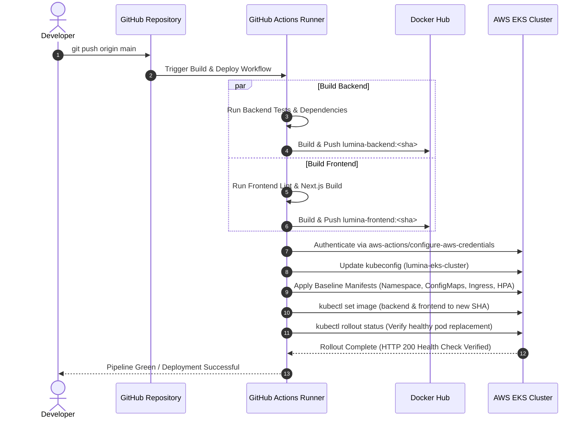

# Lumina LMS: Architecture Walkthrough & Architectural Decisions

**Document Version:** 1.0  
**Project:** Lumina Learning Management System (LMS)  
**Infrastructure Target:** AWS Elastic Kubernetes Service (EKS)  
**Author/Developer:** Praise Dania  
**Repository:** [https://github.com/praisedania/Lumina_app](https://github.com/praisedania/Lumina_app)  

---

## 1. Executive Summary & Problem Statement

Modern Learning Management Systems frequently suffer from two core architectural bottlenecks:
1. **Rigid, monolithic request handling**: Traditional LMS platforms bind real-time communications (chat, live typing, course rooms) into blocking API processes, leading to thread exhaustion during peak concurrent student sessions (such as exam start times or live lecture discussions).
2. **Infrastructure coupling & manual provisioning**: Disjointed deployments create environment drift between staging and production, resulting in unexpected downtime during updates.

**Lumina** solves these challenges by architecting the solution as a **decoupled, cloud-native microservices system** orchestrated on **AWS Elastic Kubernetes Service (EKS)**. The entire infrastructure is provisioned through declarative **Terraform Infrastructure as Code (IaC)**, and all deployments are managed by an automated **zero-downtime GitOps CI/CD pipeline**.

---

## 2. Architectural Decisions & Technology Trade-offs

| Architectural Tier | Technology Chosen | Alternatives Considered | Decision Rationale & Trade-off Analysis |
|---|---|---|---|
| **Cloud Provider** | **Amazon Web Services (AWS)** | GCP, Azure, DigitalOcean | AWS provides mature enterprise Kubernetes primitives (EKS Managed Node Groups, AWS EBS CSI Drivers, AWS Load Balancer Controller integration) and reliable Multi-AZ SLA guarantees (99.99%). |
| **Infrastructure as Code** | **Terraform (v1.10+)** | AWS CloudFormation, Pulumi | Terraform is cloud-agnostic and declarative. Using an **S3 remote backend** (`lumina-app-tf-state`) with native state locking prevents concurrent deployment race conditions and enables full infrastructure versioning. |
| **Container Orchestration** | **AWS EKS (Kubernetes v1.31)** | Amazon ECS, AWS Fargate, Docker Swarm | ECS lacks granular Kubernetes ecosystem tooling (Helm, cert-manager, Custom Resource Definitions). EKS managed node groups provide fine-grained control over instance placement, custom storage drivers, and standard Kubernetes declarative APIs without the overhead of self-managing control plane nodes. |
| **Ingress & Reverse Proxy** | **NGINX Ingress Controller + AWS NLB** | AWS ALB Ingress Controller, Traefik | Lumina requires high-throughput **WebSocket connections** for its real-time messaging layer (`/socket.io`). NGINX Ingress natively supports sticky sessions, zero-downtime reload, and direct WebSocket upgrade mechanics without ALB connection termination quirks. |
| **Frontend Framework** | **Next.js 16 (Turbopack, React 19)** | SPA (Vite/React), Remix | Server-Side Rendering (SSR) delivers superior initial page load metrics for student course discovery, while client-side components enable dynamic real-time progress calculations and immediate UI updates. |
| **Backend API & Real-time Layer** | **Node.js (ESM), Express 4, Socket.IO** | Python/FastAPI, Go/Gin | Single-thread event-loop architecture handles high-concurrency non-blocking I/O effortlessly. Co-locating Socket.IO with Express streamlines JWT authentication across HTTP REST endpoints and WebSocket handshakes using shared business logic. |
| **Relational Database** | **PostgreSQL 16 (StatefulSet + EBS gp3)** | Amazon RDS PostgreSQL, MongoDB | Running PostgreSQL as a Kubernetes StatefulSet backed by dynamic AWS EBS `gp3` storage provides complete infrastructure portability, lower operational cost during development/testing, and identical behavior in staging and production clusters. |
| **CI/CD Automation** | **GitHub Actions + Docker Hub** | Jenkins, GitLab CI, AWS CodePipeline | Native integration with GitHub repository commits; supports isolated matrix container builds, multi-platform Docker images, commit-SHA tagging, and automated Kubernetes rolling deployments upon merge to `main`. |

---

## 3. High-Availability & Multi-AZ Topology

### 3.1 Network Architecture (VPC Design)
The network foundation is deployed in a dedicated **Virtual Private Cloud (VPC)** with a `10.0.0.0/16` CIDR block in region `us-east-1`:
* **Subnets Across Multiple Availability Zones**:
  * `lumina_subnet_az1` in `us-east-1a` (`10.0.1.0/24`)
  * `lumina_subnet_az2` in `us-east-1b` (`10.0.2.0/24`)
* **Internet Gateway & Route Tables**: An AWS Internet Gateway (`lumina_igw`) provides public internet egress/ingress routed through a dedicated route table.
* **Kubernetes Cloud-Provider Tagging**: Subnets are tagged with:
  * `kubernetes.io/cluster/lumina-eks-cluster = shared`
  * `kubernetes.io/role/elb = 1`  
  This allows Kubernetes ingress controllers to automatically discover subnets and provision external AWS Network Load Balancers across both AZs.

### 3.2 Compute & Pod High Availability
* **EKS Managed Node Groups**: Minimum of 2 worker nodes (`t3.medium`) distributed across distinct physical availability zones (`us-east-1a` and `us-east-1b`).
* **Pod Redundancy**: Both the frontend (`lumina-frontend`) and backend (`lumina-backend`) deployments enforce a minimum of **2 replicas**. Kubernetes scheduling distributes pods across worker nodes, preventing single-node failures from causing service interruptions.
* **Horizontal Pod Autoscaling (HPA)**:
  * **Frontend HPA**: Scales dynamically between **2 and 6 replicas** based on 70% average CPU utilization and 80% memory utilization.
  * **Backend HPA**: Scales dynamically between **2 and 6 replicas** to handle surges during live interactive lectures and peak student activity.

---

## 4. Real-Time Communication Layer & Ingress Routing

Lumina features a rich real-time communication layer supporting:
1. **Course Rooms**: Instant peer-to-peer and instructor discussions tied to specific course enrollments.
2. **Direct Messaging (DM)**: Private student-to-instructor and student-to-student support channels.
3. **Presence System & Typing Indicators**: Visual feedback on active learners and typing status.

### 4.1 Ingress Path Routing Architecture
All external HTTP and WebSocket traffic enters through the AWS Network Load Balancer (NLB) and is processed by the **NGINX Ingress Controller**:

```
Incoming Request (HTTPS / WSS)
              │
              ▼
   [ AWS Network Load Balancer ]
              │
              ▼
 [ NGINX Ingress Controller ]
        │            │             │
  path: /      path: /api     path: /socket.io
        │            │             │
        ▼            ▼             ▼
[lumina-frontend] [lumina-backend] [lumina-backend]
 (Next.js :3000)   (Express :8000)  (Socket.IO Upgrade)
```

### 4.2 WebSocket Upgrade Mechanics
The ingress manifest ([`k8s/ingress.yaml`](./k8s/ingress.yaml)) includes specialized annotations to support persistent WebSocket streaming:
* `nginx.ingress.kubernetes.io/proxy-read-timeout: "3600"`: Prevents premature socket disconnects during long periods of idle student reading.
* `nginx.ingress.kubernetes.io/proxy-send-timeout: "3600"`: Keeps persistent bidirectional channels open.
* `nginx.ingress.kubernetes.io/websocket-services: "lumina-backend"`: Informs NGINX to handle the `Upgrade: websocket` and `Connection: Upgrade` headers without buffering.

---

## 5. Security Model & Threat Defense

### 5.1 Perimeter & Network Security
* **Strict Security Group Rules**: Ingress security groups only open ports 80 (HTTP) and 443 (HTTPS) to the public internet. Port 3000 (Frontend) and 8000 (Backend) are accessible only from within the cluster network.
* **Zero Database Exposure**: The PostgreSQL StatefulSet Service uses `type: ClusterIP`. Its database port (`5432`) is unreachable from the public internet and can only accept connections originating from authenticated pods within the `lumina` namespace.

### 5.2 IAM Least-Privilege Access Control
* **Cluster Role**: Assigned the managed `AmazonEKSClusterPolicy` allowing EKS to manage ENIs and AWS resources.
* **Worker Node Role**: Constrained strictly to worker operations (`AmazonEKSWorkerNodePolicy`, `AmazonEKS_CNI_Policy`, and `AmazonEC2ContainerRegistryReadOnly`), preventing container escapes from accessing administrative AWS APIs.

### 5.3 Secret Management & Sanitization
* All credentials (database passwords, JWT secret tokens, Resend transactional email API keys, Paystack payment gateway secrets) are stored as Kubernetes `Opaque` secrets ([`k8s/secret.yaml.example`](./k8s/secret.yaml.example)).
* Manifests containing live secrets are strictly gitignored via `.gitignore`.
* GitHub Push Protection and Secret Scanning are enabled to reject any accidental commits containing API keys.

### 5.4 Self-Healing & Startup Health Checks
* **InitContainer Barrier**: Backend pods utilize a lightweight `busybox` initContainer that executes `nc -z -v -w3 postgres 5432` until PostgreSQL is ready to accept connections. This guarantees the API pod never boots into a broken database state.
* **Liveness & Readiness Probes**:
  * Backend: Probes `/health` on port 8000 every 10–15 seconds. If a pod deadlocks, Kubernetes terminates and replaces it automatically.
  * Frontend: Probes `/` on port 3000 every 10–15 seconds to guarantee Next.js is serving rendered pages.

---

## 6. Disaster Recovery & Resilience Strategy

| Failure Scenario | Mitigation Mechanism | Recovery Time Objective (RTO) | Recovery Point Objective (RPO) |
|---|---|---|---|
| **Worker Node Hardware Failure** | EKS node health checks detect the failure and reschedule affected pods across remaining healthy nodes in the opposite AZ. | < 60 seconds | 0 seconds (Stateless pods) |
| **PostgreSQL Pod Crash** | Kubernetes StatefulSet recreates the pod; AWS EBS CSI driver automatically re-attaches the existing 10Gi `gp3` persistent volume. | < 30 seconds | 0 seconds (EBS volume persistent) |
| **Defective Code Deployment** | RollingUpdate strategy (`maxSurge: 1, maxUnavailable: 0`) keeps old pods alive until new pods pass readiness probes. Pipeline rollout timeout halts defective deployments. | Instant (No downtime) | N/A |
| **Regional AWS Outage** | Complete environment is codified in Terraform. The infrastructure can be spun up in an alternate region (`us-west-2`) by running `terraform apply`. | < 15 minutes | Dependent on database snapshot replication |

---

## 7. CI/CD GitOps Pipeline Architecture

The automated delivery pipeline is implemented via GitHub Actions ([`.github/workflows/ci-cd.yaml`](./.github/workflows/ci-cd.yaml)):



---

## 8. Summary of Engineering Achievements

1. **Enterprise Reliability**: Zero single-points-of-failure across the entire compute and networking topology.
2. **Immutable Infrastructure**: 100% of cloud resources provisioned via declarative Terraform code with remote state locking.
3. **Optimized Real-Time Performance**: Seamless WebSocket handling for collaborative learning via NGINX Ingress and Socket.IO.
4. **Automated Continuous Delivery**: Complete transition from code commit to live rolling update with automated health verification.
